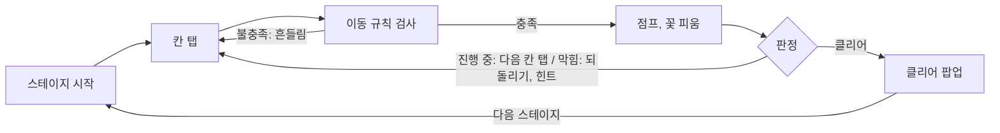
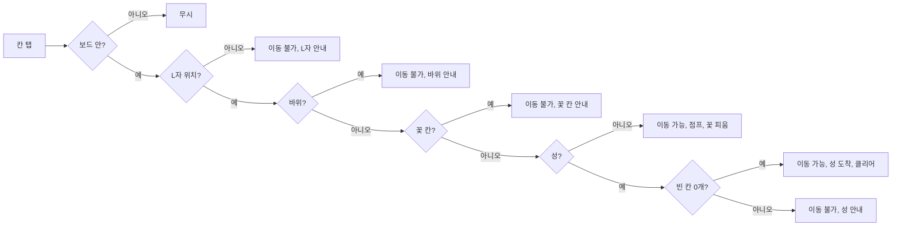
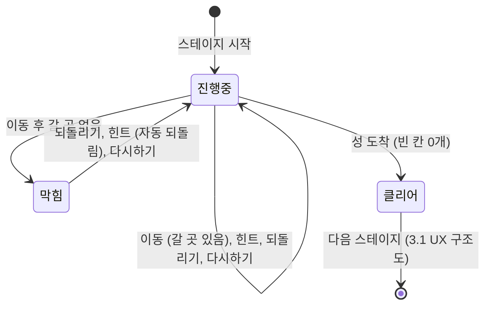
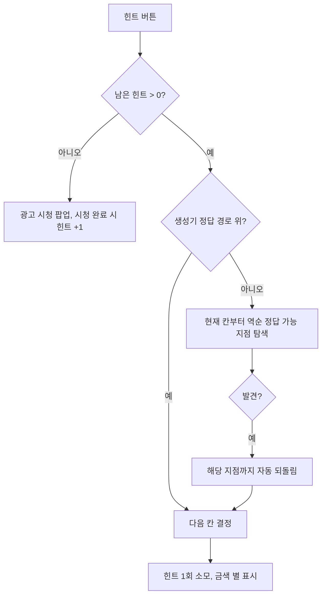

# 기사의 여행 — 퍼즐 시스템 기획서

| 항목 | 내용 |
|---|---|
| 문서 버전 | v1.6 |
| 작성일 | 2026-10-15 |
| 대상 빌드 | 웹 프로토타입 (`knight-tour/index.html`) |
| 범위 | 인게임 퍼즐 시스템 |

## 버전 관리

| 버전 | 날짜 | 변경 내용 | 변경 위치 |
|---|---|---|---|
| **v1.6** | 2026-10-15 | '한 번 더 하기' 삭제, UX 구조도를 버튼 강조형 (누른 버튼 → 도착 화면)으로 재구성 | 2.1, 3.1, 3.3, 4.4 |
| v1.5 | 2026-10-15 | 규칙, 흐름을 기능별 '게임 시스템' 장으로 통합, 판정 규칙 + 상태 전이 통합 ('이동 중' 제거), 한 턴 흐름, 피드백 연출, 부록 제외 (PPT와 동일) | 2장 |
| v1.4 | 2026-10-15 | 비주얼 컨셉: 기사 정면만 표시, 밟은 칸, 바위, 도착 성을 보드 아이콘 1개로 통합 (`images/codex/board/board_icon.png`) | 1.1 |
| v1.3 | 2026-10-15 | 3.1 화면 목록을 UX 구조도 (버튼별 화면 이동 경로)로 변경 | 3.1 |
| v1.2 | 2026-10-15 | 되돌리기, 다시하기 버튼 위치 교체, 힌트 보유제 (기본 5개, 첫 클리어 +1), 광고 시청 팝업 추가 | 2.3, 2.4, 3장, 4.5, 5.4 |
| v1.1 | 2026-10-15 | 둥근 모서리 도형을 전부 사각형으로 변경 | 전체 |
| v1.0 | 2026-10-15 | 구분 기호 가운뎃점을 쉼표로 변경, 전체 폰트 Noto Sans KR 통일 | 전체 |
| v0.9 | 2026-10-15 | Codex 픽토그램 30종 적용, 배경, 패널 색 연하게, 표 줄 간격 축소 | 전체 |
| v0.8 | 2026-10-15 | 플로우차트 예, 아니오 색 구분 (예 파랑, 아니오 빨강) 및 범례 추가, 하단 페이지 표기 제거, 버전 관리 추가 | 4.2, 4.3, 4.5, 전체 |
| v0.7 | 2026-10-14 | 전 스테이지 단일 해 반영, 기획 의도 수치 갱신 | 1.2, 2.4 |
| v0.6 | 2026-10-14 | 레벨 디자인 문서 분리, 1판 흐름, 목표, 이동 가능 판정 플로우, StringTable (다국어) | 1.1, 2장, 4.3, 5장 |
| v0.5 | 2026-10-14 | 기획 의도 (기사의 여행 알고리즘), 나이트 레퍼런스, 구조 데이터 테이블화 | 1.2, 2.1, 5장 |
| v0.4 | 2026-10-14 | 목차 순서 변경, 내용 압축, 명사형 어미, 화면 명세 4열 표 | 전체 |
| v0.3 | 2026-10-14 | 모바일 UI 화면 반영 | 3장 |
| v0.2 | 2026-10-14 | 최대 보드 8×8, 난이도 곡선, Codex 일러스트 적용 | 표지, 장 구분, 2장 |
| v0.1 | 2026-10-14 | 초안 작성 | 전체 |

## 목차

1. 개요 — 원페이지 기획서, 기획 의도
2. 게임 시스템 — 전체 흐름, 이동, 충돌 판정, 판정과 상태 전이, 보조 기능, 힌트 (레벨 디자인: 별도 문서)
3. 화면 — UX 구조도, 화면 명세
4. 구조 — StageTable, CellTypeTable, StringTable (다국어)
---

## 1. 개요

### 1.1 원페이지 기획서

L자 점프로 들판을 꽃밭으로 바꾸는 한붓그리기 퍼즐.

**기본 정보**

| 항목 | 내용 |
|---|---|
| 장르 | 하이퍼 캐주얼 퍼즐 (한붓그리기) |
| 레퍼런스 | 기사의 여행 (Knight's Tour) |
| 플랫폼 | 웹, 모바일 세로 화면 |
| 조작 | 탭 1개, 엄지 영역 버튼 |
| 플레이 시간 | 스테이지당 30초 ~ 2분 |
| 콘텐츠 | 50 스테이지, 보드 4×4 ~ 8×8 |

**게임 특징**

1. 보이는 규칙 — 항상 빛나는 이동 가능 칸, 설명 없이 바로 플레이
2. 꽃으로 채우는 진행감 — 밟은 칸마다 꽃과 순서 번호
3. 부담 없는 실패 — 무제한 되돌리기, 자동 되돌림 힌트

**비주얼 컨셉**: 2등신 SD 기사 소녀, 굵은 보라 외곽선, 파스텔 동화풍 들판

**1판 흐름, 목표**: 시작 칸의 기사 → 풀밭 채우기 (빈 칸 N → 0) → 성 도착 (마지막 한 수)

- 목표: 바위 외 모든 칸을 한 번씩 밟고 성에서 끝내기

### 1.2 기획 의도

과도한 경우의 수와 복수 정답을 덜어내 한붓그리기 퍼즐로 재구성.

**기존: 기사의 여행 (Knight's Tour)** — 체스 나이트로 판의 모든 칸을 한 번씩 밟는 경로 탐색 알고리즘.

| 문제점 | 내용 |
|---|---|
| 과도한 경우의 수 | 8×8 닫힌 경로만 약 13조 개 |
| 복수 정답 | 정답 경로가 여러 개, 목표 불명확 |
| 긴 플레이 시간 | 64칸 완주까지 한 판이 길어짐 |
| 계산 불가 | 사람이 머리로 수를 읽기 어려움 |

**개선: 기사의 여행 (본 게임)**

| 개선 | 내용 |
|---|---|
| 경로 수 대폭 축소 | 바위로 밟을 칸 축소, 경우의 수 100만 개 이하 (43/50 스테이지, 최대 약 1,430만) |
| 시작, 도착 고정 | 시작 칸과 도착 칸(성) 위치 고정 |
| 정답 1개 | 전 스테이지 정답 경로 1개로 고정 |
| 힌트 제공 | 막히면 정답 가능 지점까지 자동 되돌림 + 다음 칸 안내 |

방대한 경우의 수와 복수 정답을 줄이고 힌트를 더해, 짧고 명확한 한붓그리기 퍼즐 경험 제공.

---

## 2. 게임 시스템

### 2.1 플레이 흐름, 이동 규칙

칸 탭 → 이동 규칙 검사 → 판정의 반복으로 스테이지 진행.



**이동 규칙 검사 = 도착 칸 조건 (모두 충족 시 이동).** 체스 나이트 기반 L자 점프 (한 방향 2칸 + 수직 1칸, 최대 8곳).

- **레퍼런스: 체스 말 나이트의 이동** (점프 이동, 중간 칸 무관)

| 도착 칸 조건 | 내용 |
|---|---|
| 보드 안 | 보드 밖 좌표 제외 |
| 바위 아님 | 바위는 밟기 불가 |
| 꽃 칸 아님 | 밟은 칸 재진입 불가 |
| 성은 빈 칸 0개일 때만 | 남은 빈 칸이 없을 때만 진입 |

조건 불충족 → 칸 흔들림 + 칸 종류별 안내 대사 (2.3 충돌 판정).

### 2.3 충돌 판정

도착 칸 조건 순차 검사, 성은 빈 칸 0개일 때만 진입.



안내 문구 = StringTable 키 (STR_DLG_TAP_*)

### 2.4 판정, 상태 전이

| 판정 | 조건 | 결과 |
|---|---|---|
| 진행 중 | 빈 칸 있음, 이동 가능 칸 있음 | 이동 가능 칸 표시 |
| 막힘 | 빈 칸 있음, 이동 가능 칸 없음 | 울상, 되돌리기 강조, 벌칙 없음 |
| 클리어 | 빈 칸 없이 성 도착 | 만세, 꽃잎 연출, 클리어 팝업 |



점프 연출 0.32초 동안 입력 무시.

### 2.5 보조 기능 규칙

| 기능 | 횟수 | 내용 |
|---|---|---|
| 되돌리기 | 무제한 | 마지막 이동 1회 취소, 시작 칸에서 비활성 |
| 다시하기 | 언제든 | 스테이지 초기 상태로 복귀, 보유 힌트 유지 |
| 힌트 | 기본 5개 | 다음 칸 금색 별 표시, 정답 없으면 자동 되돌림 후 표시<br>첫 클리어 시 +1, 0개일 때 광고 시청으로 +1 |

### 2.6 힌트 규칙

1. 현재 위치에서 성까지의 완주 경로 계산
2. 경로 있음 → 힌트 1회 소모, 다음 칸 표시
3. 경로 없음 → 경로가 있는 가장 최근 칸으로 자동 되돌림 후 표시
4. 힌트 0개 → 광고 시청 팝업, 시청 완료 시 힌트 +1

- 정답 경로: 전 스테이지 1개, 힌트가 그 경로 안내
- 계산 지연: 생성기 정답 경로로 대체, 항상 답 제공

> 스테이지 생성, 난이도, 레벨 데이터: `레벨디자인_기획서.md` 참조

### 2.7 힌트 처리 흐름



---

## 3. 화면

### 3.1 UX 구조도

누른 버튼에서 도착 화면으로, 인게임 중심 4개 화면. 실선 = 버튼 탭, 점선 = 자동 전환.

```mermaid
flowchart LR
    START([게임 시작]) -- 마지막 플레이 스테이지 --> G[인게임]
    G -- 스테이지 버튼 --> SEL[스테이지 선택 시트]
    SEL -- 스테이지 N 탭 --> G
    SEL -- 닫기, 바깥 탭 --> G
    G -. 성 도착 0.55초 .-> CLR[클리어 팝업]
    CLR -- 다음 스테이지 → N+1 --> G
    CLR -- 다음 스테이지 (마지막) --> SEL
    G -- 힌트 (보유 0개) --> AD[광고 시청 팝업]
    AD -- 광고 보고 힌트 받기 → 재생 3초 → 힌트 +1 --> G
    AD -- 닫기, 바깥 탭 --> G
```


### 3.2 화면 명세 — 인게임

상태 → 대사 → 보드 → 엄지 영역 조작 순 배치. 실제 화면: `images/s10_progress.png`

| 번호 | 이름 | 유형 | 기능 |
|---|---|---|---|
| 1 | 스테이지 버튼 | 버튼 | 현재 스테이지 번호, 보드 크기 표시<br>탭 시 스테이지 선택 시트 열림 |
| 2 | 진행 바 | 게이지 | 밟은 칸 / 전체 칸 표시<br>칸을 밟을 때마다 막대 증가 |
| 3 | 기사 초상 | 이미지 | 기사의 현재 표정 표시 (기본, 점프, 울상, 만세) |
| 4 | 말풍선 | 텍스트 | 상황별 안내, 반응 대사 표시 |
| 5 | 보드 | 패널 | N×N 칸 표시, 화면 폭 정사각형, 하단 배치<br>이동 가능 칸 마커, 힌트 별 표시 |
| 6 | 기사 | 이미지 | 현재 위치 표시, 이동 시 포물선 점프 |
| 7 | 다시하기 | 버튼 | 스테이지 초기 상태로 복귀, 보유 힌트 유지 |
| 8 | 힌트 | 버튼 | 다음 칸 금색 별 표시, 보유 힌트 수 뱃지<br>0개 시 AD 뱃지, 탭 시 광고 시청 팝업 |
| 9 | 되돌리기 | 버튼 | 마지막 이동 1회 취소<br>막힘 시 바운스 강조, 시작 칸에서 비활성 |

### 3.3 화면 명세 — 클리어 팝업

성 도착 0.55초 후 표시. 실제 화면: `images/s3_clear.png`

| 번호 | 이름 | 유형 | 기능 |
|---|---|---|---|
| 1 | 클리어 일러스트 | 이미지 | 만세 기사 표시, 위아래 들썩임 |
| 2 | 제목 | 텍스트 | "스테이지 N 클리어!" 표시<br>마지막 스테이지는 "모든 여행 완료!" |
| 3 | 설명 | 텍스트 | 밟은 칸 수, 성 도착 안내 |
| 4 | 기록 | 텍스트 | 되돌리기, 힌트 사용 횟수 표시 |
| 5 | 보상 | 텍스트 | 첫 클리어 시 "힌트 +1" 표시 |
| 6 | 다음 스테이지 | 버튼 | 다음 스테이지 즉시 시작<br>마지막 스테이지는 스테이지 선택 시트 열림 |

### 3.4 화면 명세 — 스테이지 선택 시트

하단에서 올라오는 시트, 전 스테이지 자유 선택. 실제 화면: `images/select.png`

| 번호 | 이름 | 유형 | 기능 |
|---|---|---|---|
| 1 | 제목 | 텍스트 | "어디로 여행할까?" 표시 |
| 2 | 스테이지 목록 | 패널 | 50개 스테이지 5열 그리드 표시<br>세로 스크롤, 잠금 없음 |
| 3 | 스테이지 버튼 | 버튼 | 번호, 보드 크기 표시, 탭 시 해당 스테이지 시작<br>분홍 클리어, 노랑 현재, 연보라 미클리어 |
| 4 | 안내 문구 | 텍스트 | 상태 색 안내 표시 |
| 5 | 닫기 | 버튼 | 시트 닫기, 바깥 영역 탭으로도 닫힘 |

### 3.5 화면 명세 — 광고 시청 팝업

힌트 0개에서 힌트 탭 시 표시, 시청 완료 시 힌트 +1. 실제 화면: `images/ad_popup.png`

| 번호 | 이름 | 유형 | 기능 |
|---|---|---|---|
| 1 | 아이콘 | 이미지 | 힌트 아이콘 표시 |
| 2 | 제목 | 텍스트 | "힌트가 없어요" 표시 |
| 3 | 설명 | 텍스트 | 광고 시청 보상 안내 (힌트 1개) |
| 4 | 광고 보고 힌트 받기 | 버튼 | 보상형 광고 재생, 시청 완료 시 힌트 +1<br>프로토타입: 3초 대기 화면으로 대체 |
| 5 | 닫기 | 버튼 | 팝업 닫기, 안내 대사 출력<br>바깥 영역 탭으로도 닫힘 |

---

## 4. 구조

### 4.1 데이터 테이블 구성

테이블 3종 + 레벨 설정 (레벨 디자인 기획서).

| 테이블 | 역할 | 참조 |
|---|---|---|
| StageTable | 스테이지별 보드, 시작, 도착 정의 | CellTypeTable |
| CellTypeTable | 칸 종류별 밟기 가능 여부, 전환 규칙 | — |
| StringTable | 대사, UI 문구 다국어 관리 | 게임 로직이 키로 참조 |
| LevelConfig | 레벨 생성 파라미터 (레벨 디자인 기획서) | StageTable 생성 |

원칙: 수치, 문구 하드코딩 금지, 테이블 키로만 참조.

### 4.2 StageTable

| 필드 | 타입 | 설명 |
|---|---|---|
| stage_id | int | 스테이지 번호 (PK) |
| board_size | int | 보드 한 변 (4~8) |
| stage_type | enum | N 일반, H 관문, L 먼 길 |
| step_count | int | LEN, 답까지 총길이 (시작, 성 포함) |
| seed | int | 맵 생성 시드 |
| start_cell | int | 시작 칸 번호 (y × n + x) |
| goal_cell | int | 성 칸 번호 |
| case_count | int | 경우의 수 (검수용) |

값 산출, 스테이지별 데이터: 레벨 디자인 기획서.

### 4.3 CellTypeTable

| cell_type_id | 이름 | walkable | enter_condition | on_enter | on_undo |
|---|---|---|---|---|---|
| 0 | 빈 칸 (GRASS) | Y | 없음 | → 1 (꽃 칸) | — |
| 1 | 꽃 칸 (FLOWER) | N | — | — | → 0 (빈 칸) |
| 2 | 바위 (ROCK) | N | — | — | — |
| 3 | 성 (CASTLE) | 조건부 | 빈 칸 0개 | → 1, 클리어 | — |

### 4.4 StringTable

문구 44행 (대사 17, UI 27), 언어 추가 = 열 추가. 게임 적용 완료 (ko, en, ja 전체 행).

| string_key | category | ko | en | ja |
|---|---|---|---|---|
| STR_UI_UNDO | UI | 되돌리기 | Undo | 戻す |
| STR_UI_HINT | UI | 힌트 | Hint | ヒント |
| STR_UI_CLEAR_TITLE | UI | 스테이지 {stage} 클리어! | Stage {stage} Clear! | ステージ{stage}クリア！ |
| STR_DLG_STAGE_START | DIALOGUE | 풀밭 {count}칸을 전부 밟고 깃발 성에 도착하자! | Step on all {count} tiles and reach the flag castle! | {count}マス全部踏んで旗のお城へ！ |
| STR_DLG_MOVE | DIALOGUE | 좋아! 남은 풀밭 {count}칸. | Nice! {count} tiles left. | いいね！残り{count}マス。 |
| STR_DLG_TAP_ROCK | DIALOGUE | 바위는 밟을 수 없어! | You can't step on rocks! | 岩は踏めないよ！ |
| STR_DLG_CLEAR | DIALOGUE | 성에 도착! 들판이 온통 꽃밭이야! | Made it! The whole field is in bloom! | お城に到着！野原が一面お花畑！ |

다국어 확장 규칙

1. 키 참조 — 코드는 string_key만 참조
2. 언어 = 열 — zh_CN, zh_TW 등 열 추가
3. 폴백 — 번역 누락 시 ko 출력
4. 이름 파라미터 — {count}, {stage}, 어순 변경 대응
5. 길이 검수 — UI 문구 언어별 최대 길이 확인

---
